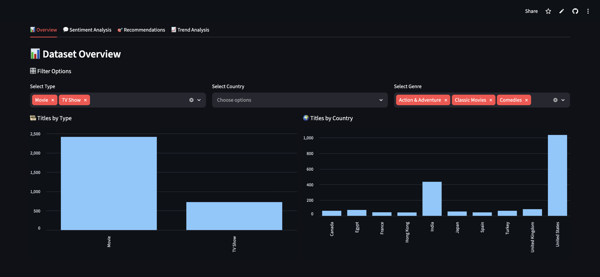
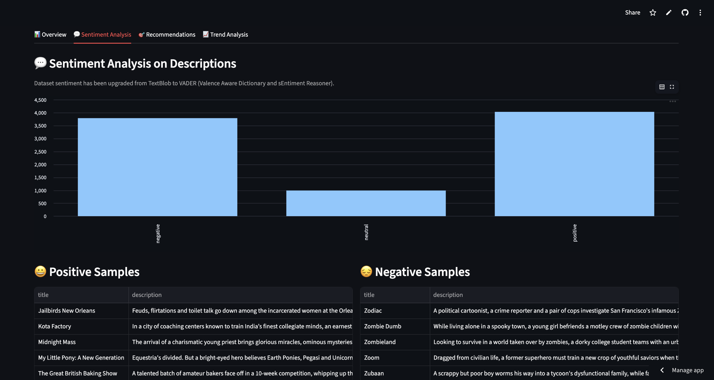
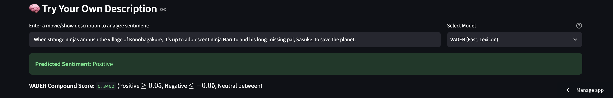
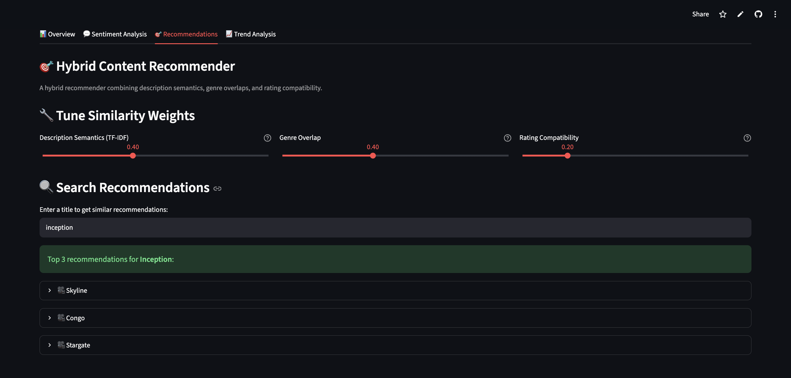
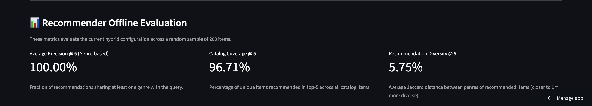
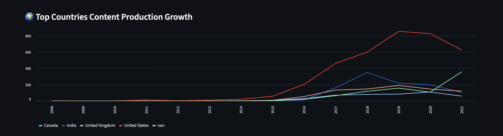
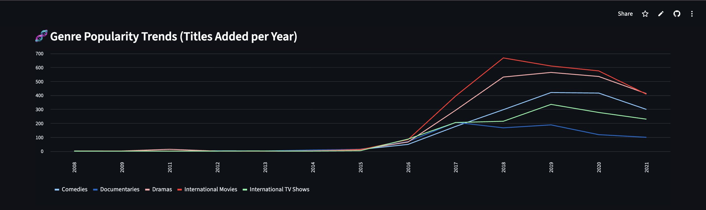
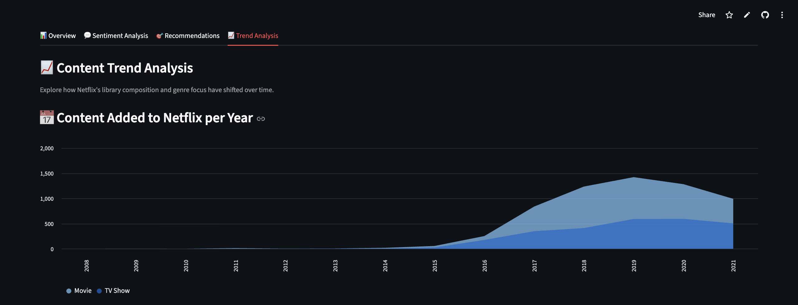

# 🎬 NetData

An interactive Streamlit analytics and recommendation dashboard for exploring Netflix content with sentiment analysis, a tunable hybrid recommender system, and historical trend visualizations.

**Tech stack:** Streamlit · Pandas · Scikit-learn · VADER + DistilBERT (sentiment analysis) · TF-IDF + Multi-Hot Genre & Rating Similarity (hybrid recommender)

---

## 🌟 Key Features

### 1. 📊 Interactive Dataset Overview & Filtering
- Multi-criteria filtering by **Content Type** (Movies / TV Shows), **Country of Production**, and **Genre**.
- Dynamic visualizations of catalog composition:
  - **Titles by Type** distribution bar charts.
  - **Titles by Country** breakdown (Top 10 producing nations).



---

### 2. 💬 Sentiment Analysis
- **Catalog-wide Sentiment Distribution**: Analyzes the emotional tone across descriptions using VADER (Valence Aware Dictionary and sEntiment Reasoner).
- **Positive & Negative Showcases**: Real-time sample inspection of positive and negative titles.
- **On-Demand Description Testing**:
  - Test custom descriptions interactively.
  - Choose between **VADER** (lexicon-based, real-time score) and **DistilBERT** (Hugging Face transformer-based classification) with confidence metrics.

| Sentiment Distribution & Samples | Interactive Sentiment Testing |
|:---:|:---:|
|  |  |

---

### 3. 🎯 Hybrid Content Recommender
- **Multi-Factor Similarity Engine**:
  - **Description Semantics**: TF-IDF vectorization with cosine similarity on synopsis text.
  - **Genre Overlap**: Multi-hot genre encoding measuring overlap.
  - **Rating Compatibility**: Target audience maturity matching.
- **Tunable Weights**: Real-time interactive sliders to adjust the relative importance of descriptions, genres, and ratings.
- **Expandable Recommendations**: Detailed cards displaying matched genre, content rating, and plot summaries.



#### 📈 Offline Evaluation Metrics
Built-in evaluation engine analyzing hybrid performance across catalog samples:
- **Average Precision@5 (Genre-based)**: Measures fraction of recommendations sharing core genres with the query.
- **Catalog Coverage@5**: Percentage of unique catalog items reached across top-5 recommendations.
- **Recommendation Diversity@5**: Average Jaccard distance between recommended item genres to guard against filter bubbles.



---

### 4. 📈 Content Trend Analysis
Examines historical growth and industry shifts in Netflix's catalog (2008–present):
- **Library Growth Over Time**: Stacked area chart of Movies vs. TV Shows added per year.
- **Genre Evolution**: Multi-line tracking of top genre popularity shifts over the years.
- **Geographic Production Growth**: Longitudinal production output analysis across top producing countries.

| Library Growth (Movies vs TV) | Genre Trends Over Time | Country Production Growth |
|:---:|:---:|:---:|
|  |  |  |

---

## 🚀 Setup & Installation

```bash
# Clone the repository
git clone https://github.com/TanV404/NetData.git
cd NetData

# Create and activate virtual environment
python -m venv venv
source venv/bin/activate  # Windows: venv\Scripts\activate

# Install dependencies
pip install -r requirements.txt

# Run the Streamlit app
streamlit run app.py
```

---

## 📁 Project Structure

```
NetData/
├── data/
│   └── netflix_titles.csv     # Netflix dataset
├── screenshots/               # Dashboard preview images
├── src/
│   ├── data_cleaning.py       # Data preprocessing utilities
│   ├── recommender.py         # TF-IDF & hybrid recommendation engine + evaluation
│   └── sentiment_analysis.py  # VADER & DistilBERT sentiment classifiers
├── app.py                     # Streamlit multi-tab web application
└── requirements.txt           # Python dependencies
```

